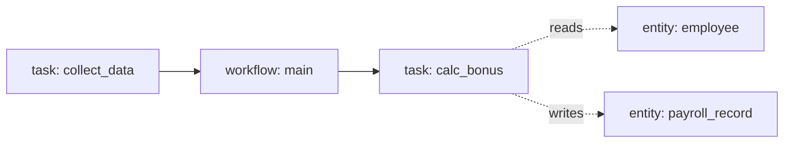

# pdm-explain-bp — погружение в бизнес-процесс PDM

**Цель.** За один заход дать пользователю (или себе) полную картину
выбранного БП: что входит, как связаны компоненты, какие были архитектурные
решения, и как он работает в проде сейчас.

## Когда использовать

Триггеры в сообщении пользователя (RU/EN):
- «расскажи как устроен <slug>», «объясни процесс <slug>»
- «что делает <slug>», «введи меня в курс <slug>»
- "tell me about bp X", "explain process Y"

Не использовать когда:
- пользователь хочет править БП → `pdm-edit-process`
- пользователь дебажит конкретный упавший прогон → `pdm-debug-failed-run`

## Предусловия

1. В репо есть `processes/<slug>/` или БП существует в PDM-prod.
2. MCP-серверы `pdm-prod` и `pdm-sandbox` сконфигурированы в `.claude/mcp.json`.
3. Если `pdm-prod` MCP недоступен — скилл не падает, помечает соответствующие
   секции «(данные недоступны: pdm-prod MCP не отвечает)».

## Шаги

### 1. Discovery

a) Вызови `pdm-prod.get_process_summary(slug)`. Если `not found` — проверь
   локально `processes/<slug>/manifest.yaml`. Если и локально нет — отвечай
   «БП `<slug>` не найден» и заверши работу (не выдумывай структуру).
b) Прочитай `processes/<slug>/manifest.yaml` (через Read) — источник истины.
c) Прочитай `processes/<slug>/decisions/*.md` (канонический формат —
   `pdm:decision-format`). Бери только актуальные: `status: decided`
   с пустым `superseded_by:`. Файлы со `status: superseded` пропускай.
d) Если `processes/<slug>/` отсутствует — предложи `pdm pull --bp <slug>`.

### 2. Структура — mermaid-схема

Из summary + локальных tasks/workflows составь mermaid-диаграмму
task → workflow → entity. Пример:

Связи:
- `processes/<slug>/tasks/<task>.yaml` — `inputs`/`outputs`/`entity_links`
- `processes/<slug>/workflows/<wf>.logical.yaml` — какие tasks дёргаются

### 3. Решения и контекст

a) Список `decisions/*.md` в формате `- YYYY-MM-DD — <topic> (decided)`.
b) Покажи последние 3–5 git-tag'ов: `git tag -l 'v*' | tail -5`.

### 4. Свежая телеметрия и обратная связь

a) `pdm-prod.get_telemetry_aggregates(since="7d", bp_slug=slug)` -> total, by_status, duration percentiles, top failing steps, orphan egress, and assignment breakdown.
b) Если есть error-runs:
   - для до 3 последних дёрни `pdm-prod.get_run_details(run_id)` и достань
     `error_summary` + название упавшего step'а.
c) `pdm-prod.get_feedback(bp_slug=slug, status="new", since="30d")` → если есть
   открытые тикеты, перечисли топ-3.
d) Подведи итог одним абзацем:
   «За прошлую неделю N прогонов, K% успешных. Топ-1 ошибка: `<step>` —
    `<error_summary>`. Открытых пользовательских тикетов: M.»

## Антипаттерны

- **Не запускать** `pdm test` или `pdm pull` без явной просьбы — скилл
  ознакомительный, не активный.
- **Не править файлы** — все шаги read-only.
- **Не выдумывать структуру**, если БП не найден ни локально ни в PDM.
- **Не вызывать `get_process`** (тяжёлый full export), если достаточно
  `get_process_summary` + точечных `get_entity_schema`.

## Aggregates vs per-run telemetry

- Use `pdm-prod.get_telemetry_aggregates(since, bp_slug=slug)` for pattern
  questions: failure rate, slowest steps, top failing steps, orphan egress
  hosts, duration percentiles, and assignment status breakdowns. Prefer one
  aggregate call over iterating `search_telemetry` plus `get_run_details`.
- Use `pdm-prod.search_telemetry(bp_slug=slug, since=...)` when you need a
  list of runs.
- Use `pdm-prod.get_run_details(run_id)` when you need one run's assignments,
  history, egress, or error context.

## Privacy for feedback

`pdm-prod.get_feedback(...)` reads exported production feedback tickets from
`feedback/tickets/*.md`. Treat them as real user reports. Do not echo names,
contacts, free-form personal details, or other sensitive fragments back to the
user; summarize patterns and operational impact instead. The UI warns users not
to submit PII, but the skill must assume tickets can still contain it.

## Postcondition

Один структурированный ответ пользователю: mermaid-схема + список decisions
+ сводка по телеметрии и фидбэку. Никаких файлов не создаём.
